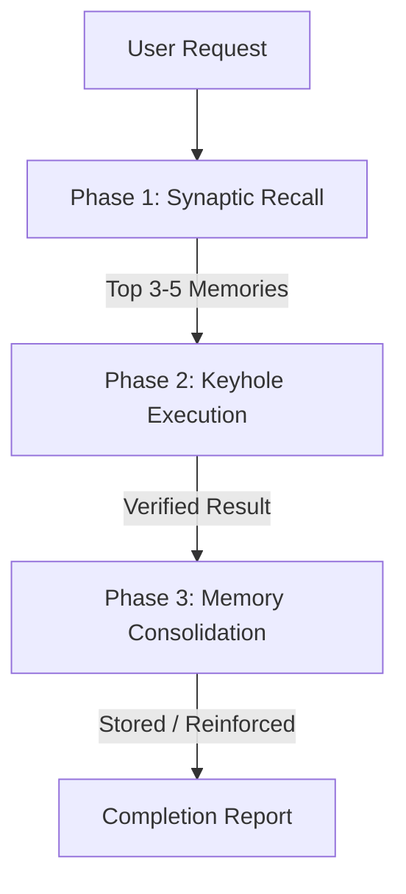

# Cynapse Synaptic Memory

Lifelong, local, zero-cloud persistent memory engine for autonomous AI coding agents. Based on the [Cynapse Sovereign Agent Architecture](https://github.com/Alartist40/cynapse).

Commercial AI agents suffer from **context amnesia**: when a chat thread or prompt session ends, all learned architectural constraints, user corrections, and codebase subtleties vanish. Standard vector databases (Pinecone, Chroma) require network calls, monthly subscriptions, and cloud exposure.

Cynapse Synaptic Memory solves this locally in under 150 milliseconds using a **4-tier biological memory model** with Ebbinghaus exponential decay.

---

## 1. The 4 Memory Tiers

| Tier | Biological Role | Half-Life | Typical Content |
| :--- | :--- | :--- | :--- |
| **Working** | Short-term scratchpad | 1 Day | Current task blockers, ephemeral debug logs, active ticket IDs |
| **Episodic** | Event & session history | 7 Days | "Refactored auth middleware on Oct 24", past compiler failures |
| **Semantic** | Factual & project knowledge | 30 Days | "Database is PostgreSQL 16 on port 5433", architecture constraints |
| **Procedural** | Hardened execution rules | 90 Days (or Pinned) | "Always run cargo test before commit", error recovery playbooks |

---

## 2. Agent Execution Protocol

Every agent equipped with this skill must follow the **Recall $\rightarrow$ Execute $\rightarrow$ Consolidate** loop:



### Phase 1: Synaptic Recall (Before Any Significant Action)

Before proposing an implementation plan or editing code, query the synaptic memory for existing constraints, preferences, and verified patterns:

```bash
<skill-dir>/bin/cynapse-synaptic-memory query "<brief description of task or keywords>"
```

**Context Budgeting Rule**:
- The recall command returns strictly $\le 4$ formatted markdown bullets ($\le 120$ tokens).
- Read the returned bullets and honor all `[SEMANTIC]` constraints and `[PROCEDURAL]` rules during planning.

### Phase 2: Keyhole Surgery File Protection

To prevent context overflow and file truncation (a frequent failure mode where agents overwrite 800-line files to change 4 lines):
1. **Never rewrite entire files** when modifying existing functions.
2. Target exact line bounds and matching character anchors.
3. If an edit fails, check line offsets rather than blindly repeating the write.

### Phase 3: Memory Consolidation (After Task Completion)

When you discover an architectural invariant, receive an explicit user correction, or resolve a tricky error, consolidate the finding into long-term memory:

#### Storing a Project Fact (Semantic):
```bash
<skill-dir>/bin/cynapse-synaptic-memory remember \
  --tier semantic \
  --content "Project uses pnpm instead of npm; bun is strictly disallowed" \
  --tags "package-manager,pnpm,rules"
```

#### Storing a Hardened Rule / Fix (Procedural):
```bash
<skill-dir>/bin/cynapse-synaptic-memory remember \
  --tier procedural \
  --content "When modifying auth.rs, always run 'cargo test test_jwt' to verify token signature" \
  --tags "rust,auth,testing" \
  --pinned
```

#### Storing a Session Milestone (Episodic):
```bash
<skill-dir>/bin/cynapse-synaptic-memory remember \
  --tier episodic \
  --content "Migrated database schema to v4 adding user_preferences table" \
  --tags "migration,database,v4"
```

---

## 3. Mathematical Decay & Automatic Pruning

Unused memories fade naturally following Ebbinghaus's exponential forgetting curve:

$$\text{Effective Strength} = e^{-\lambda \Delta t} \times \left(1 + 0.2 \cdot \ln(1 + \text{Access Count})\right)$$

Where:
- $\lambda = \frac{\ln(2)}{\text{Half-Life in Seconds}}$
- $\Delta t = \text{Time elapsed since last recall}$
- Pinned memories (`--pinned`) have $\text{Effective Strength} = 1.0$ (never decay).

### Periodic Maintenance
Prune expired memories below the 5% retention threshold:
```bash
<skill-dir>/bin/cynapse-synaptic-memory prune --threshold 0.05
```

Inspect database health and memory tier counts:
```bash
<skill-dir>/bin/cynapse-synaptic-memory stats
```

---

## 4. Verification Gate

Before declaring this skill installed and functional:
1. Run `<skill-dir>/bin/cynapse-synaptic-memory stats`.
2. Confirm the Rust binary executes with 0ms startup time and reports `Engine: Native Rust`.
